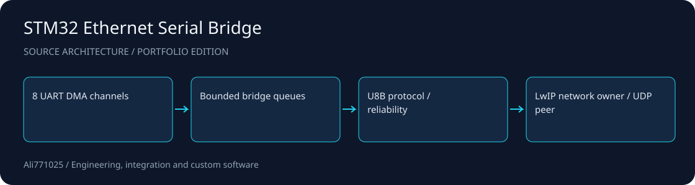

# STM32 Ethernet Serial Bridge

<!-- project-contact:start -->
**Work with Yosof Omrani:** [Email a project inquiry](mailto:aliomrani916@gmail.com) · **aliomrani916@gmail.com** · [Services & contact](https://ali771025.github.io/software-portfolio/en/contact/) · [Portfolio walkthrough](https://ali771025.github.io/software-portfolio/en/#projects)
<!-- project-contact:end -->

**An STM32H723 firmware architecture for eight independent UART channels transported over UDP.**

Embedded C · FreeRTOS · LwIP · DMA

[راهنمای فارسی](docs/README.fa.md) · [Architecture](docs/ARCHITECTURE.md) · [Discuss a project](https://github.com/Ali771025)

## What this demonstrates

- Separated application, protocol, bridge, network-owner and platform modules.
- Versioned U8B framing, CRC, channel/session identity and bounded reliability machinery.
- CubeMX configuration, IAR workspace, UART DMA integration and Ethernet diagnostics.

## Source map

| Path | Responsibility |
| --- | --- |
| `App/` | Composition and UART integration |
| `Bridge/` | Routing and reliability |
| `Protocol/` | Wire codec |
| `Net/` | Network ownership |
| `Platform/` | Diagnostics and hardware support |

## Setup and integration

This edition selects the v2 STM32H723VGTx tree. It uses the 25 MHz HSE / LAN8742 configuration described by the supplied CubeMX source, rather than the older 12 MHz / LAN8720A tree. Install matching STM32CubeH7 HAL/CMSIS, FreeRTOS and LwIP components using their original licenses and restore the Drivers/Middlewares paths referenced by the IAR project. Open `cubeMX.ioc` and `EWARM/Project.eww` with compatible CubeMX / IAR EWARM. Review pinout, clock, DMA/cache placement, PHY and Board-A/B addressing for your board. Published network addresses are documentation examples.

## Scope and evidence

Compact source edition: vendor dependency trees, schematic/customer files, HEX binaries and board evidence are excluded. Existing vendor notices in application files are retained. No current build, ping, UART integrity, electrical or hardware qualification result is claimed. Buffer overflow and retry exhaustion require explicit degraded-state handling.

This public portfolio edition contains selected source and integration manifests. Contracts, private data, customer materials, original Git history, dependency trees and large assets are excluded. No tests, builds or application runs were performed for this publication; no previous result is presented as a current validation.

## Work with me

I am available for projects involving Embedded C, FreeRTOS, LwIP, DMA. For a useful first discussion, share the problem, target environment, expected deliverables and acceptance criteria. I can help scope an implementation, integration or improvement around your constraints.

Contact: [Ali771025 on GitHub](https://github.com/Ali771025). Please share confidential material through an agreed private channel.

## Rights and dependencies

Publication for portfolio review does not grant a new blanket license. Existing file notices and dependency terms continue to apply. Contact the author to agree terms for reuse or a commercial engagement.
