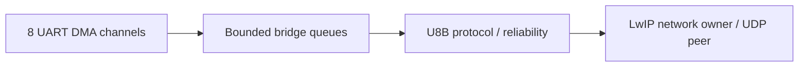

# STM32 Ethernet Serial Bridge architecture

The diagram describes the source responsibilities, not a measured production deployment.

| Module | Responsibility |
| --- | --- |
| `App/` | Composition and UART integration |
| `Bridge/` | Routing and reliability |
| `Protocol/` | Wire codec |
| `Net/` | Network ownership |
| `Platform/` | Diagnostics and hardware support |

Compact source edition: vendor dependency trees, schematic/customer files, HEX binaries and board evidence are excluded. Existing vendor notices in application files are retained. No current build, ping, UART integrity, electrical or hardware qualification result is claimed. Buffer overflow and retry exhaustion require explicit degraded-state handling.
